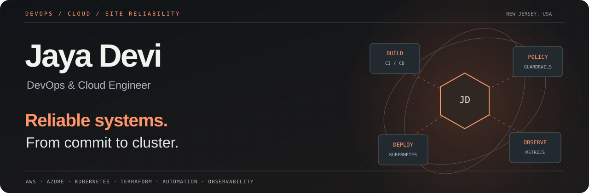
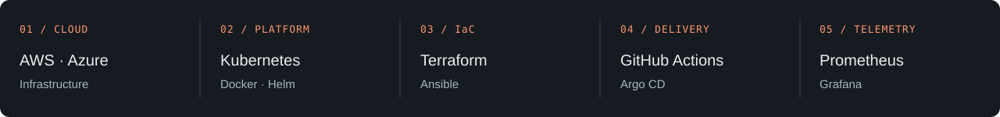
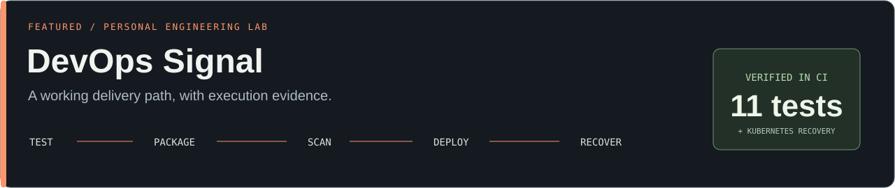

  

  <a href="https://jaya-devi-portfolio.vercel.app/">Explore my portfolio ↗</a>
  &nbsp; · &nbsp;
  <a href="https://github.com/devijhanu130-hub/devops-signal">Inspect the code ↗</a>
  &nbsp; · &nbsp;
  <a href="mailto:devijhanu130@gmail.com">Get in touch ↗</a>

### Infrastructure should be understandable, repeatable, and resilient.

I’m **Jaya Devi**, a DevOps / Cloud Engineer based in New Jersey. My work spans cloud infrastructure, Kubernetes platforms, automated delivery, and observability. I care about systems that engineering teams can deploy confidently and troubleshoot clearly.

### Featured engineering lab · DevOps Signal

A personal lab that makes the whole delivery path visible: **test → package → scan → deploy → verify → recover**.

| What’s inside | What the evidence shows |
| :--- | :--- |
| Python HTTP service | **11 passing HTTP tests locally** covering health, readiness, metrics, errors, configuration, and concurrent requests |
| Non-root Docker container | Build and read-only runtime smoke test passed in GitHub Actions |
| Security checks | Trivy passed the configured gate for fixable HIGH / CRITICAL findings; workflow actions use pinned commits |
| Kubernetes on Kind | Automated rollout, HTTP verification, controlled readiness failure, and recovery passed |
| Observability | Working direct-metrics dashboard verified locally in healthy, degraded, disconnected and recovery states; Prometheus config validated, live scrape unverified |

**[Repository](https://github.com/devijhanu130-hub/devops-signal)** · **[Successful pipeline run](https://github.com/devijhanu130-hub/devops-signal/actions/runs/39854092436)** · **[Recovery runbook](https://github.com/devijhanu130-hub/devops-signal/blob/main/docs/runbook.md)** · **[Portfolio case study](https://jaya-devi-portfolio.vercel.app/#personal-project)**

Personal learning project, developed with AI assistance. The Kubernetes cluster is temporary. This is execution evidence for a demo, not a production availability claim.

### See monitoring in action

[Dashboard code, failure screenshots and reproduction steps](https://github.com/devijhanu130-hub/devops-signal/blob/main/docs/dashboard.md). Screenshots show a running personal demo, not a production system.

### How I approach a system

**Automate the repeatable work.** Keep infrastructure and delivery steps in version control.

**Make failure observable.** Distinguish an unhealthy process from one that is temporarily not ready for traffic.

**Show the evidence.** Link tests, workflow results, and operational notes instead of relying on a tool list.

---

**Let’s talk cloud platforms, DevOps, and reliability.**  
[Portfolio](https://jaya-devi-portfolio.vercel.app/) · [Email](mailto:devijhanu130@gmail.com) · New Jersey, USA
